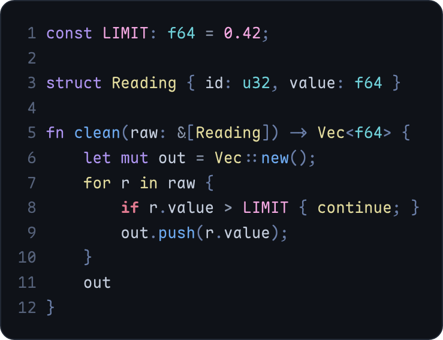
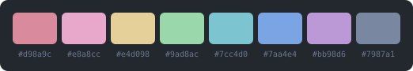
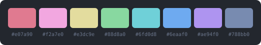
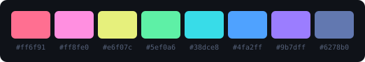
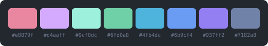
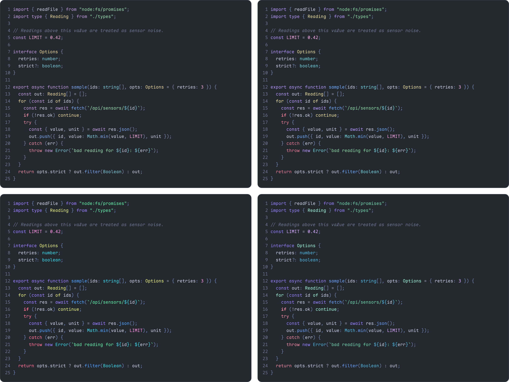

**Rime**

a colder colorscheme



It is a opposite of [bark](https://github.com/if-not-nil/bark) with a mix of [one dark pro](https://github.com/Binaryify/OneDark-Pro)

**variants**

four of them, all on the same `#0f1218` background

- **rime**: the original. every syntax role is clearly apart

  
- **rime glacier**: soft, muted pastels for long sessions

  
- **rime aurora**: vivid neon on the same cold base

  
- **rime abyss**: the coldest one. no yellow or orange, rose is the only warm color. its "yellow" is pale aqua, so yellow terminal warnings look close to green

  



**[neovim](./nvim)**

with lazy.nvim

```lua
{
  "w0x7y/Rime",
  lazy = false,
  priority = 1000,
  config = function(plugin)
    vim.opt.rtp:append(plugin.dir .. "/nvim")
    vim.cmd.colorscheme("rime")
  end,
}
```

then `:colorscheme rime`, `rime-glacier`, `rime-aurora` or `rime-abyss`. other plugin managers, options and lualine are in [nvim/](./nvim)

**[zed](./zed)**

put `zed/themes/rime.json` into `~/.config/zed/themes/`, or run `zed: install dev extension` and pick the `zed/` folder. then choose a rime variant in the theme selector

zed puts `if`, `for` and `return` in one group, so there they share a color

**[vscode](./vscode)**

```sh
cd vscode
npx @vscode/vsce package
code --install-extension rime-theme-0.1.0.vsix
```

then `Preferences: Color Theme` and pick a rime variant

**[base16](./general/base16)**

the same 16 colors per variant. there's a base16 template for almost any software, so you can feed these to a builder like tinty

- [tinted-theming](https://github.com/tinted-theming/home) is a good place to find templates and builders

**[terminals and the rest](./general)**

kitty, alacritty, ghostty, wezterm, foot, windows terminal, iterm2, xresources, css variables and fzf

for kitty, put `general/kitty/rime.conf` into `~/.config/kitty/rime.conf`, then add `include rime.conf` to your kitty config. the others are explained in [general/](./general)

**[changing colors](./palettes)**

every variant is 16 colors in `palettes/`. edit one and run `python3 tools/build.py`. it rewrites the zed, vscode, terminal and neovim palette files with only the python standard library

**[your own](https://github.com/w0x7y/Rime/pulls)**

if you port it into your software of choice, open a pull request

*credits: [bark](https://github.com/if-not-nil/bark) by if-not-nil, the warm scheme rime flips around. license: [mit](./LICENSE)*
