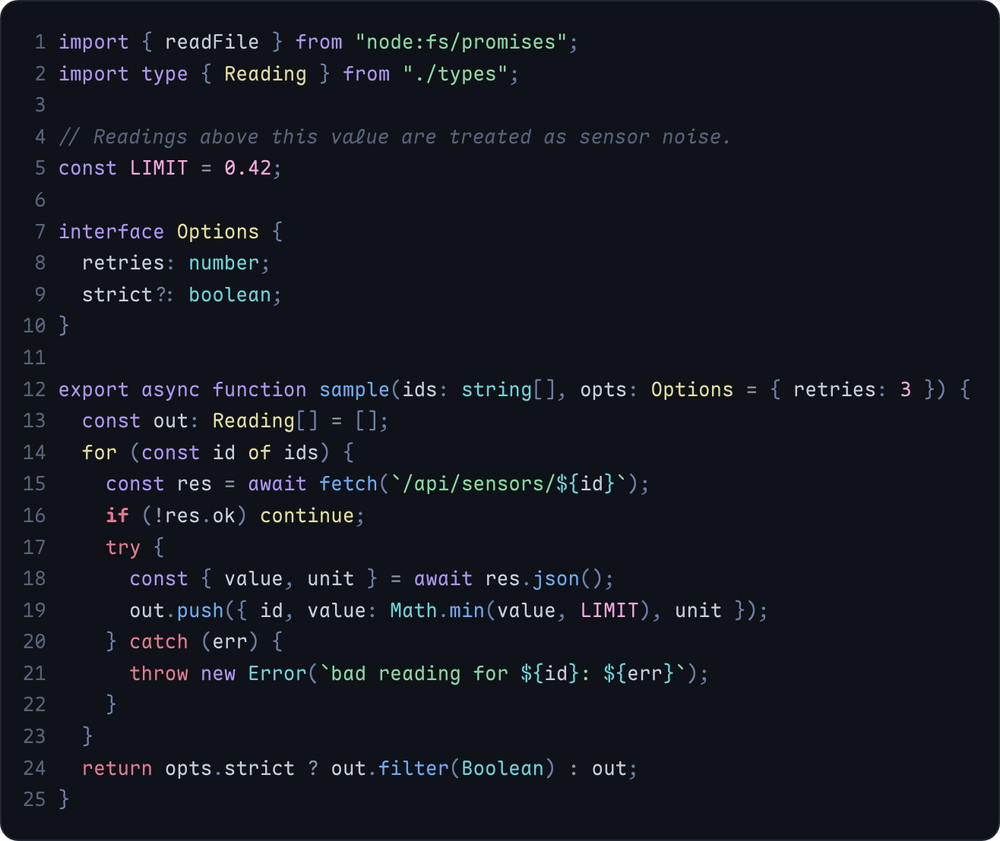

# Rime for Neovim



A Lua colour scheme with four variants:

| Command | Variant |
|---|---|
| `:colorscheme rime` | Rime |
| `:colorscheme rime-glacier` | Rime Glacier |
| `:colorscheme rime-aurora` | Rime Aurora |
| `:colorscheme rime-abyss` | Rime Abyss |

It covers the editor UI, legacy syntax groups, treesitter captures, LSP semantic tokens, diagnostics and terminal colours. It also styles gitsigns, mini.diff, telescope, fzf-lua, snacks, nvim-cmp, blink.cmp, which-key, indent-blankline, flash, noice, lazy.nvim, mason, nvim-tree, neo-tree and lualine.

Tested on Neovim 0.12. Treesitter capture names follow Neovim 0.10+.

## Install

**lazy.nvim**

```lua
{
  "w0x7y/Rime",
  lazy = false,
  priority = 1000,
  config = function()
    require("rime").setup({})
    vim.cmd.colorscheme("rime")
  end,
}
```

**vim.pack** (Neovim 0.12+)

```lua
vim.pack.add({ "https://github.com/w0x7y/Rime" })
vim.cmd.colorscheme("rime")
```

**vim-plug**

```vim
Plug 'w0x7y/Rime'
" after plug#end()
colorscheme rime
```

**packer.nvim**

```lua
use("w0x7y/Rime")
-- after packer has loaded it
vim.cmd.colorscheme("rime")
```

**Manual**

```sh
git clone https://github.com/w0x7y/Rime ~/.local/share/nvim/site/pack/rime/start/rime
```

Earlier versions kept the plugin in the repository's `nvim/` folder. If your config adds that folder to the runtime path or sets `rtp = 'nvim'`, remove it. The plugin now sits at the top of the repository.

## Configuration

`setup()` is optional. Call it before `:colorscheme` if you want to change anything. These are the defaults:

```lua
require("rime").setup({
  transparent = false,     -- leave the background unset so the terminal shows through
  terminal_colors = true,  -- set vim.g.terminal_color_0..15
  dim_inactive = false,    -- darker background in inactive windows
  styles = {
    comments = { italic = true },
    keywords = {},
    conditionals = { bold = true },
    functions = {},
    strings = {},
    variables = {},
    types = {},
  },
  on_colors = nil,      -- function(colors, variant) end
  on_highlights = nil,  -- function(highlights, colors, variant) end
})
```

A style table replaces the default rather than merging into it, so `comments = {}` turns comment italics off. `keywords` applies to every keyword kind except conditionals, which use `conditionals`.

`on_colors` changes the colours before any group is built. Derived shades such as `bg_dark`, `border` and the diff backgrounds follow your changes:

```lua
require("rime").setup({
  on_colors = function(c, variant)
    c.bg = "#0b0e13"
    if variant == "abyss" then
      c.yellow = "#e3dc9e"
    end
  end,
})
```

`on_highlights` lets you change any group before it is applied:

```lua
require("rime").setup({
  on_highlights = function(hl, c)
    hl.LineNr = { fg = c.steel }
    hl.CursorLine = { bg = c.bg_sel }
  end,
})
```

Colour names available in `c`:

- Base colours: `bg`, `bg_alt`, `bg_sel`, `comment`, `muted`, `fg`, `fg_bright`, `white`, `red`, `pink`, `yellow`, `green`, `cyan`, `blue`, `violet`, `steel`
- Derived shades: `bg_dark`, `border`, `colorcolumn`, `whitespace`, `search`, `diff_add`, `diff_change`, `diff_text`, `diff_delete`, and the diagnostic virtual-text backgrounds `diag_error`, `diag_warn`, `diag_info`, `diag_hint`, `diag_ok`
- `none`, meaning "NONE" (no colour)

## Using the colours elsewhere

```lua
local c = require("rime").colors("abyss") -- "rime", "glacier", "aurora", "abyss" or a full name like "rime-abyss"; on_colors is applied
print(c.blue)
```

## lualine

lualine picks up the matching theme automatically with `theme = "auto"`. You can also name one directly:

```lua
require("lualine").setup({ options = { theme = "rime-glacier" } })
```

## Keyword colours

Rime gives each kind of keyword its own colour instead of painting them all the same:

| Treesitter group | Colour | Examples |
|---|---|---|
| `@keyword`, `@keyword.function`, `@keyword.import` | violet | `const`, `function`, `import` |
| `@keyword.repeat` | yellow | `for`, `while`, `continue` |
| `@keyword.conditional` | bold rose | `if`, `else` |
| `@keyword.return`, `@keyword.exception` | rose | `return`, `try`, `throw` |

To make every keyword one colour, link them back in `on_highlights`:

```lua
on_highlights = function(hl)
  for _, g in ipairs({ "@keyword.repeat", "@keyword.conditional", "@keyword.return", "@keyword.exception" }) do
    hl[g] = { link = "Keyword" }
  end
end
```

## Files

- `lua/rime/init.lua`: `setup`, `load` and `colors`
- `lua/rime/groups.lua`: all highlight groups
- `lua/rime/lualine.lua`: the lualine theme for any variant

`tools/build.py` generates these from `palettes/` and its `SYNTAX` table, so don't edit them by hand:

- `colors/*.lua`: one entry point per variant
- `lua/lualine/themes/*.lua`: one lualine theme per variant
- `lua/rime/palettes/*.lua`: the colours of each variant
- `lua/rime/variants.lua`: the variant names, default first
- `lua/rime/syntax.lua`: the colour and default style of each syntax role, shared with Zed and VS Code
